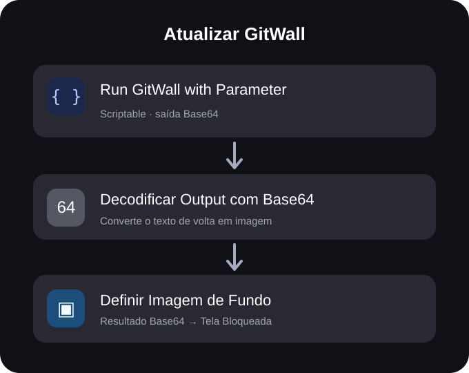

<div align="center">

# GitWall iOS

### Seu GitHub na tela bloqueada. Atualizado automaticamente.

Transforme suas contribuições públicas do GitHub em um wallpaper para iPhone: quadradinhos verdes, fundo azul e atualização programada — **sem iCloud e sem precisar manter o computador ligado**.

<br/>


<br/>

<sub>Captura real no iPhone 11 · Perfil @palomagl · 722 contribuições na data da foto</sub>

<br/><br/>

**[Começar instalação](#instalação--passo-a-passo)** &nbsp;·&nbsp; **[Ver o código](script/gitwall.js)** &nbsp;·&nbsp; **[Configurar atualização automática](#3-atualizar-automaticamente-todos-os-dias)**

</div>

---

## O projeto em 3 passos

| 01 · Scriptable | 02 · Atalhos | 03 · Automação |
| :---: | :---: | :---: |
| Gera o wallpaper com seus dados do GitHub | Decodifica a imagem e aplica na tela bloqueada | Atualiza diariamente no horário escolhido |

<div align="center">

</div>

> **Importante:** o wallpaper não atualiza instantaneamente após cada commit. Ele é atualizado quando a automação é executada. Esta versão foi testada no **iPhone 11**; outros modelos podem precisar de ajustes no layout.

## Como funciona

O **Scriptable** consulta o calendário público de contribuições do seu GitHub, desenha o wallpaper e entrega a imagem ao **Atalhos** por Base64. O Atalhos decodifica e aplica o resultado à tela bloqueada. Não é necessário configurar armazenamento no iCloud, servidor, token do GitHub ou manter o computador ligado.

> **Importante:** a imagem **não muda imediatamente a cada commit**. O iPhone atualiza quando o atalho é executado (manualmente ou no horário da automação). A contagem segue as regras de contribuições do GitHub; nem todo commit aparece necessariamente no gráfico.

## Requisitos

- iPhone com iOS compatível com a ação **Definir Imagem de Fundo** do Atalhos.
- Aplicativo gratuito [Scriptable](https://apps.apple.com/app/scriptable/id1405459188).
- Aplicativo **Atalhos** (Shortcuts), da Apple.
- Conexão com a internet para consultar o GitHub durante a atualização.
- **Layout preparado para iPhone 11 (828 × 1792 px)**. Outros modelos precisam de ajuste nas dimensões e, possivelmente, no posicionamento do gráfico.

## Instalação — passo a passo

### 1. Criar o script no Scriptable

1. Instale e abra o [Scriptable](https://apps.apple.com/app/scriptable/id1405459188).
2. Toque em **+** para criar um script; nome sugerido: `GitWall`.
3. Abra [`script/gitwall.js`](script/gitwall.js), copie **todo o conteúdo** e cole no editor do Scriptable.
4. Procure a linha abaixo e troque `palomagl` pelo **seu** usuário público do GitHub (sem `@`):

   ```javascript
   const USUARIO = "palomagl";
   ```

5. Salve e toque em **Executar (▶)**. Se for solicitado, permita o acesso à rede.
6. Confira se o wallpaper aparece com os quadrados e o total de contribuições. Caso o GitHub não responda, confira a internet e o nome de usuário.

**Não altere esta parte do código:**

```javascript
const dadosPNG = Data.fromPNG(imagem);
Script.setShortcutOutput(dadosPNG.toBase64String());
```

Ela entrega a imagem codificada ao Atalhos e evita ter que buscar arquivos em pastas do iCloud.

### 2. Montar o atalho que troca o wallpaper

1. Abra **Atalhos → +** e crie o atalho `Atualizar GitWall`.
2. Adicione a ação do Scriptable chamada **Run Script** / **Executar Script**. Toque no campo **Script** e selecione o script criado no passo 1. Deixe o **Parameter** vazio. Nas opções da ação, deixe **Run In App** e **Mostrar ao Executar** desligados, quando disponíveis.
3. Adicione a ação **Codificar/Decodificar Base64**. Toque no primeiro campo e selecione **Decodificar**. Como entrada, selecione a variável **Output** da primeira ação (Scriptable).
4. Adicione a ação **Definir Imagem de Fundo** / **Set Wallpaper Photo**. No campo da imagem, selecione a variável de saída da **segunda ação** (às vezes chamada **Codificado em Base64**, mesmo quando está em modo Decodificar). **Não use o Output do Scriptable diretamente nessa terceira ação.**
5. Na terceira ação, escolha **Tela Bloqueada**. Desative **Mostrar Pré-visualização** e **Recortar no Tema**, se aparecerem.
6. Toque em **▶** para testar e permita o acesso necessário. Bloqueie o iPhone para verificar o resultado.

As ações devem ficar **nesta ordem**:

```text
[Scriptable: Run GitWall]
          ↓  Output (texto Base64)
[Decodificar Output com Base64]
          ↓  resultado decodificado (imagem)
[Definir Imagem de Fundo → Tela Bloqueada]
```

<details>
<summary>Ver diagrama das três ações no Atalhos</summary>


O nome do script e os textos podem variar conforme o idioma e a versão do iOS.

</details>

### 3. Atualizar automaticamente todos os dias

Depois que o teste manual estiver funcionando:

1. Abra a aba **Automação** no app Atalhos.
2. Toque no **+** e escolha **Hora do Dia**.
3. Defina o horário desejado (por exemplo, **07:00**) e marque **Diariamente**.
4. Se disponível, escolha **Executar Imediatamente** / desative a confirmação.
5. Na escolha do que executar, selecione **Atualizar GitWall** e salve.

Pronto. Quando essa automação conseguir executar com conexão, ela vai buscar novamente as contribuições e substituir a imagem da tela bloqueada. O iOS pode solicitar permissões na primeira execução e pode limitar ou impedir execuções em determinadas condições.

## Personalização

No começo do arquivo [`script/gitwall.js`](script/gitwall.js), você encontra:

| Variável | Para que serve |
| --- | --- |
| `USUARIO` | Seu usuário público do GitHub |
| `LARGURA`, `ALTURA` | Dimensões da imagem (padrão: iPhone 11) |
| `COLUNAS` | Número de quadrados por linha |
| `PASSO`, `QUADRADO` | Distância e tamanho dos quadrados |
| `INICIO_Y` | Posição vertical do gráfico |
| `NIVEL` | Cores de cada nível de contribuição |

O relógio da prévia no iPhone é o relógio **nativo do iOS**; ele não é desenhado pelo script.

## Problemas comuns

**A imagem aparece no Scriptable, mas não muda na tela bloqueada.** Verifique se a segunda ação está em **Decodificar Base64** e se a terceira usa o **resultado da segunda ação**, não o `Output` original. Execute o atalho manualmente e confira as permissões.

**Erro “Unsupported shortcut output”.** Não use `Script.setShortcutOutput(imagem)`: objetos de imagem do Scriptable não são aceitos diretamente como saída do atalho. Use a versão Base64 fornecida neste repositório.

**O iCloud está cheio.** Esta versão **não salva a imagem no iCloud**. Ela transfere os dados do script diretamente ao Atalhos. O Scriptable ainda precisa estar instalado no iPhone.

**O número de contribuições parece diferente.** O script lê o calendário público do GitHub, não um histórico irrestrito de commits. Contribuições privadas não visíveis publicamente não são incluídas, e as regras de atribuição/contagem são do GitHub.

**O gráfico está desalinhado em outro iPhone.** O padrão foi desenvolvido para 828 × 1792 px; ajuste dimensões e `INICIO_Y` conforme seu modelo.

**O script parou de obter dados.** A leitura depende da estrutura pública da página de contribuições do GitHub, que pode mudar. Confira a conexão e se a página de contribuições carrega normalmente.

## Tecnologias

JavaScript · Scriptable · iOS Shortcuts · GitHub Contributions

## Créditos

Projeto e documentação: [@palomagl](https://github.com/palomagl). A imagem acima é uma captura real da tela bloqueada da autora. O resultado varia conforme as contribuições de cada pessoa.

Código aberto sob a licença [MIT](LICENSE). Este projeto é independente e não é afiliado ao GitHub ou à Apple.