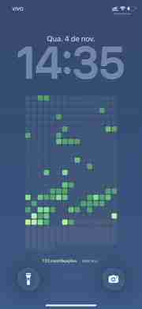

<div align="center">

# GitWall iOS

**Seu GitHub. Na tela bloqueada.**

Wallpaper com o calendário de contribuições do GitHub, atualizado pelo iPhone — **sem iCloud, sem token e sem computador ligado**.



<sub>Captura real no iPhone 11 · @palomagl</sub>

<br><br>

[**Instalar**](#instalação) · [**Ver código**](script/gitwall.js) · [**Automatizar**](#atualização-automática)

</div>

---

## Como funciona

**GitHub → Scriptable → Atalhos → Tela bloqueada**

O Scriptable busca o calendário público, desenha os quadradinhos e entrega a imagem em Base64. O Atalhos decodifica e define o wallpaper. Tudo acontece no próprio iPhone.

| Compatibilidade | Atualização | Armazenamento |
| :--- | :--- | :--- |
| **iPhone 11**, testado | **Diária**, via automação | **Sem iCloud** |

> Esta versão tem layout de **828 × 1792 px** (iPhone 11). Outros iPhones podem exigir ajustes. A tela muda quando o atalho executa, **não a cada commit em tempo real**.

## Instalação

### 01 — Criar o script

1. Instale o [Scriptable](https://apps.apple.com/br/app/scriptable/id1405459188).
2. Abra o app, toque em **+** e crie um script chamado `GitWall`.
3. Copie o conteúdo de **[script/gitwall.js](script/gitwall.js)** e cole no Scriptable.
4. No início do código, troque pelo seu usuário do GitHub:

   ```js
   const USUARIO = "seu-usuario";
   ```

5. Toque em **▶**. O wallpaper deve aparecer com as suas contribuições.

### 02 — Montar o Atalhos

No app **Atalhos**, crie `Atualizar GitWall` e adicione **estas 3 ações, na ordem**:

| Ordem | Ação | Configuração |
| :---: | :--- | :--- |
| **1** | **Run Script** (Scriptable) | Escolha `GitWall`. Parâmetro vazio. **Run In App** desligado |
| **2** | **Codificar/Decodificar Base64** | Mude para **Decodificar**. Entrada: `Output` da ação 1 |
| **3** | **Definir Imagem de Fundo** | Imagem: **resultado da ação 2**. Destino: **Tela Bloqueada** |

**Na ação 3**, desative **Mostrar Pré-visualização** e **Recortar no Tema**, se disponíveis. O resultado da segunda ação pode aparecer com o nome *Codificado em Base64* mesmo estando no modo Decodificar.

**Teste:** toque em **▶**, permita os acessos solicitados e bloqueie a tela. O wallpaper deve mudar.

### 03 — Atualização automática

No **Atalhos → Automação → +**:

1. Selecione **Hora do Dia** e marque **Diariamente**.
2. Escolha o horário (ex.: **07:00**) e **Executar Imediatamente**.
3. Selecione o atalho **Atualizar GitWall**.

Pronto. O iPhone tentará gerar e aplicar o wallpaper todos os dias com internet. A execução em segundo plano depende das permissões e condições do iOS.

## Ajustes rápidos

| No código | O que muda |
| :--- | :--- |
| `USUARIO` | Conta do GitHub |
| `LARGURA` / `ALTURA` | Resolução do wallpaper |
| `INICIO_Y` | Altura em que começam os quadradinhos |
| `NIVEL` | Tons de verde |

O relógio e a data são elementos **nativos do iOS**, não fazem parte da imagem gerada.

<details>
<summary><strong>Problemas comuns</strong></summary>

**A imagem aparece no Scriptable, mas não muda na tela bloqueada?** Na última ação, selecione a saída da **decodificação Base64**, não `Output` direto do Scriptable. Confirme que o destino é **Tela Bloqueada**.

**“Unsupported shortcut output”?** Use o código deste repositório: ele envia **Base64**, não um objeto Image.

**iCloud cheio?** Não precisa liberar espaço: o fluxo passa a imagem diretamente ao Atalhos.

**Os commits não apareceram?** O calendário segue as regras do GitHub para contribuições públicas e pode levar um tempo para refletir atividades recentes.

**Outro modelo de iPhone?** Ajuste resolução e posicionamento do gráfico no código.

</details>

---

<div align="center">
<sub>Feito por <a href="https://github.com/palomagl">@palomagl</a> · <a href="LICENSE">MIT License</a> · Projeto independente, sem vínculo com Apple ou GitHub.</sub>
</div>
